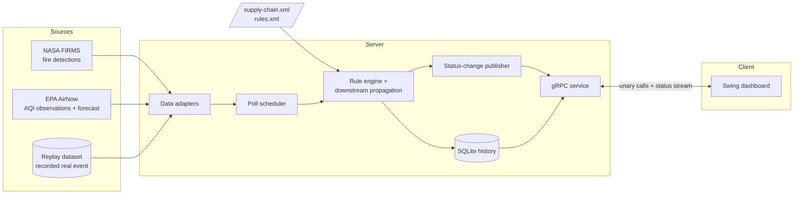
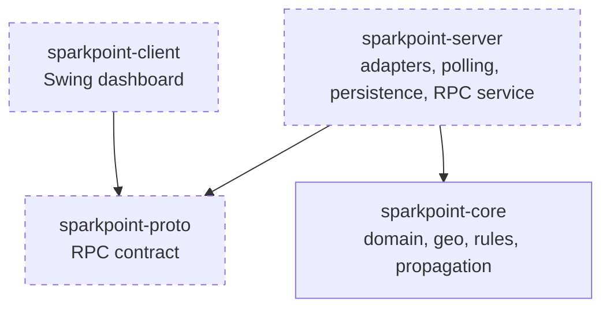
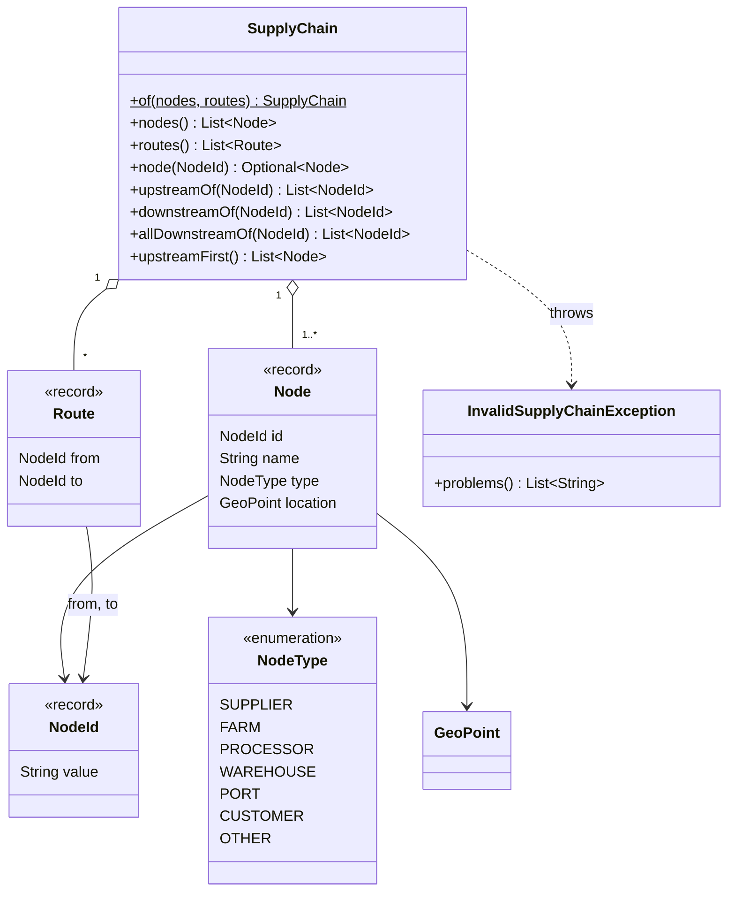

# SparkPoint Design

This document describes SparkPoint as built. It grows one section per
milestone; the roadmap and the reasoning behind the stack are in
[PLAN.md](PLAN.md).

## 1. Architecture overview

SparkPoint is two programs. The **server** collects fire and air-quality data,
evaluates the supply chain, and keeps the history. The **client** is a desktop
dashboard that asks the server for the current picture and listens for changes.

### Modules and their dependencies

Dashed modules are planned and do not exist yet. Two rules hold the structure
together:

- **`sparkpoint-core` is pure.** It has no compile-scope dependencies and does
  no network, database, file-watching or UI work. Everything in it can be
  tested with plain objects.
- **The client knows only the contract.** It never depends on core or server
  classes, so everything it shows has crossed the RPC boundary.

### Cross-cutting decisions

| Decision | Reason |
|---|---|
| All time comes from an injected `java.time.Clock`. | Replay runs a past event on a simulated clock, and tests are deterministic. |
| Data sources sit behind interfaces with live and replay implementations. | The server cannot tell a recorded fire from a live one, so the demo exercises the real code path. |
| Missing data is an explicit state, never treated as "clear". | A node with no nearby air monitor must not look safe. |
| Compiler warnings fail the build. | Problems are fixed when introduced, not accumulated. |

### Build

Maven multi-module, run through the Maven Wrapper (`./mvnw verify`). The parent
POM pins every dependency and plugin version, requires Java 21 or newer, and
produces a JaCoCo coverage report per module. `sparkpoint-core` additionally
fails the build below 90% line or 85% branch coverage. GitHub Actions runs the
same command on every pull request.

## 2. Geographic model

`GeoPoint` (in `sparkpoint-core`, package `geo`) is a latitude/longitude pair in
decimal degrees on WGS 84, the datum both data sources use. It validates its
range on construction, so no other code needs to check coordinates again.
Distance calculations are added in Milestone 1.

## 3. Supply-chain graph

Package `chain` in `sparkpoint-core` models the chain as a directed graph
without cycles. "Upstream" means towards the origin of the goods, "downstream"
towards the customer.

`SupplyChain.of` is the only way to create a chain, and it validates
everything, so any `SupplyChain` that exists is usable. It rejects:

| Problem | Example message |
|---|---|
| No nodes | `a supply chain needs at least one node` |
| Repeated node id | `node id 'farm' is used more than once` |
| Route to or from a missing node | `route farm -> ghost ends at unknown node 'ghost'` |
| Repeated route | `route farm -> shop is listed more than once` |
| Cycle | `routes form a cycle, so nothing in it comes first: a -> b -> c -> a` |

Decisions:

- **All problems are reported together.** A user fixing a hand-written file
  should not have to run it once per mistake.
- **Cycles are rejected.** A disruption propagates downstream; in a cycle every
  node is downstream of itself and there is no first node to evaluate.
- **`upstreamFirst()` is a topological order** (Kahn's algorithm), computed
  once at construction. The propagation step in Milestone 2 walks it so that a
  node's upstream statuses are known before its own. Ties are broken by the
  order nodes appear in the file, so the result is deterministic.
- **`NodeType` is descriptive only.** No rule behaves differently by type.
- **A `Route` carries only its two ends for now.** Transit time and priority
  are added when the delay estimate in Milestone 2 needs them.
- **The chain is immutable.** It is shared between the polling threads and the
  RPC threads later, and an immutable object needs no locking.
