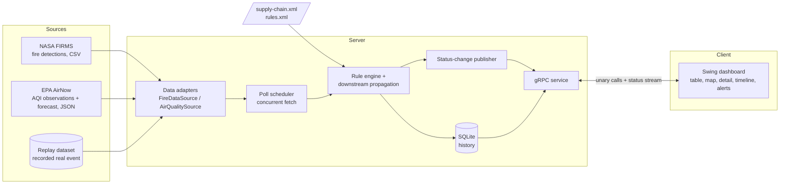

# SparkPoint Project Plan

Status: **approved** (2026-11-16). Source proposal: [PROPOSAL.md](PROPOSAL.md).

SparkPoint is a client-server desktop tool that maps wildfire and smoke exposure
onto a user-defined supply chain. This is a solo personal project: Claude writes
the code, Sam reviews it. There is no deadline, so the plan is ordered by
dependency, not by calendar week.

## 1. Goals

| Goal | What it means in practice |
|---|---|
| Reviewable | Work lands as small pull requests, each with tests and a short note on the design choices made. |
| Fully tested | Test-first throughout; every module has unit tests, the system has an end-to-end test driven by replay data, and CI runs all of it. |
| Demo-able | Replay mode runs a real past fire offline, at adjustable speed, with no API keys. |
| Documented | A design document with class, sequence and data-flow diagrams grows alongside the code. |

Out of scope, as in the proposal: predicting fire spread, market or price
effects, enterprise multi-tenant features, and a mapping library.

## 2. Recommended stack

| Area | Choice | Why |
|---|---|---|
| Language | **Java 21 (LTS)** | Already installed. Adds records, sealed types, pattern-matching `switch` and virtual threads over the proposed Java 17, all of which make the domain model and the concurrent polling shorter and easier to review. |
| Build | **Maven, multi-module, with the Maven Wrapper** | Declarative and easy to read in review. The wrapper (`./mvnw`) means no Maven install is needed on any machine or in CI. |
| RPC | **gRPC with Protocol Buffers** | Replaces RMI. The whole remote API lives in one `.proto` file that can be reviewed on a page, server-streaming gives status-change push (Observer across the wire) without RMI's client-callback and registry quirks, and it avoids Java serialization. |
| Client UI | **Swing with the FlatLaf look and feel** | Ships with the JDK, so nothing platform-specific to break. `Graphics2D` is enough for the hand-drawn map. FlatLaf makes it look current. |
| Database | **SQLite through plain JDBC** (xerial `sqlite-jdbc`) | One local file, no server, in-memory mode for tests. Plain JDBC keeps the SQL visible. |
| HTTP | `java.net.http.HttpClient` (JDK) | No extra dependency. |
| JSON / CSV / XML | Jackson for AirNow JSON; a small hand-written parser for FIRMS CSV; JDK JAXP with an XSD for the supply-chain file | FIRMS returns CSV, not JSON. An XSD gives users precise errors for a malformed chain file. |
| Tests | JUnit 5, AssertJ, hand-written fakes, gRPC in-process transport, JaCoCo coverage | Fakes over mocks follows the PayStation style and keeps tests readable. |
| CI | GitHub Actions running `./mvnw verify` on every pull request | Reviews start from a green build. |
| Diagrams | Mermaid, embedded in Markdown | Renders on GitHub and in IntelliJ, and diffs as text in pull requests. |
| IDE | **IntelliJ IDEA** (already installed; Community edition is sufficient) | It is the right IDE for Java and Maven, and it is JetBrains. |

Alternatives considered:

- **RMI** (the original proposal): zero dependencies, but legacy, built on Java
  serialization, and awkward for server-to-client callbacks. Still a valid
  choice if the goal were to practise the course material specifically.
- **JavaFX**: nicer controls and CSS styling, at the cost of a separate
  platform-specific dependency. A reasonable swap if the dashboard's looks
  become a priority.
- **Kotlin with Compose Desktop**: the most JetBrains-native option, but only
  sensible if Kotlin is as comfortable to review as Java.
- **A web client** (TypeScript, browser map): easiest to share, but drops the
  desktop and hand-drawn-map parts of the proposal.

## 3. Architecture

### Modules

| Module | Contents | Depends on |
|---|---|---|
| `sparkpoint-core` | Domain model, geographic maths, supply-chain graph, XML loading, rules, propagation, trend. Pure Java: no network, no database, no clock except an injected one. | nothing |
| `sparkpoint-proto` | The `.proto` contract and generated gRPC stubs. | nothing |
| `sparkpoint-server` | FIRMS, AirNow and replay adapters; poll scheduler; SQLite persistence; gRPC service; server `main`. | core, proto |
| `sparkpoint-client` | Swing dashboard, gRPC client, presentation models. | proto |

The client depends only on the contract, never on server or core classes, so
the remote boundary is real.

### Design patterns

- **Adapter**: `FireDataSource` and `AirQualitySource` interfaces, each with a
  live implementation and a replay implementation. One shared contract test
  runs against every implementation.
- **Strategy**: each rule is its own class behind a `Rule` interface.
- **Observer**: the engine publishes status changes to listeners; the gRPC
  service is one listener and forwards them down each client's stream.
- **Repository**: persistence sits behind interfaces, with SQLite and in-memory
  implementations.
- **Injected clock**: all time comes from a `java.time.Clock`, which is what
  makes replay and deterministic tests possible.

### Status model (proposed, to be finalised in Milestone 2)

Severity order: `CLEAR < WATCH < DELAYED < DISRUPTED`.

- **Direct status** comes from rules on the node itself: `CLEAR`, `WATCH` (a
  lower threshold is crossed, for example a fire within the watch radius or a
  poor AQI forecast) or `DISRUPTED` (an upper threshold is crossed).
- **Propagated status**: a node with a `DISRUPTED` or `DELAYED` upstream
  dependency, or a disrupted inbound route, becomes `DELAYED` with an estimated
  delay in hours. `WATCH` does not propagate, but is listed in the downstream
  node's detail pane.
- A node's final status is the more severe of the two.
- Every status carries its **reasons**: the rule, the evidence (which
  detection, which reading), the measured value and the threshold. The detail
  pane shows exactly these, which is the "shows why" promise of the proposal.

### Initial rules

| Rule | Triggers on |
|---|---|
| `FireProximityRule` | A fire detection within a watch radius or a disruption radius of a node, filtered by detection confidence. |
| `AqiThresholdRule` | Current AQI at a node at or above a watch or disruption level. |
| `AqiForecastRule` | Forecast AQI at or above a level (produces `WATCH` only). |
| `RouteFireProximityRule` | A fire detection within a corridor distance of the straight-line route between two nodes. |

Thresholds live in `rules.xml`, separate from the chain definition.

### Trend indicator (not a prediction)

For each node, compare the distance to the nearest fire detection across recent
time windows and label it **Approaching**, **Steady** or **Receding**. It
describes what has been observed and nothing more.

## 4. Testing strategy

| Level | What | How |
|---|---|---|
| Unit | Geo maths, graph validation, each rule, propagation, trend, parsers | JUnit 5, written before the code |
| Contract | Every `FireDataSource` and `AirQualitySource` implementation | One abstract test class per interface |
| Adapter | FIRMS CSV and AirNow JSON parsing, error and rate-limit handling | Recorded response files; a local stub HTTP server; no live calls in CI |
| Persistence | Schema, queries, history | SQLite in-memory |
| RPC | Service behaviour and the status stream | gRPC in-process transport |
| Client | Presentation models (table rows, map projection, alert logic) | Tested without opening a window; Swing views stay thin |
| End-to-end | Replay dataset in, expected status timeline out | A golden-file test over the full server |
| Live smoke | Real FIRMS and AirNow calls | Opt-in, run locally with keys, never in CI |

JaCoCo reports coverage on every build, with a minimum enforced on
`sparkpoint-core`.

## 5. Milestones

Each milestone is a handful of pull requests. A milestone is done when its
pull requests are merged, CI is green, and its design-document section and
diagrams are written.

| # | Milestone | Delivers | Design-doc additions |
|---|---|---|---|
| 0 | **Skeleton** | GitHub repo, Maven modules, wrapper, CI, README, licence, `.gitignore`, `CLAUDE.md` with project conventions | Architecture overview |
| 1 | **Core model** | Nodes, routes, graph with cycle and reference validation, haversine and point-to-route distance, XML schema and loader, sample Northern California almond chain | Domain class diagram |
| 2 | **Rules and propagation** | The four rules, `rules.xml`, propagation with delay estimate and chain-impact summary, reasons | Rule and propagation diagrams; final status model |
| 3 | **Data adapters and replay** | FIRMS and AirNow adapters, replay adapters, a recorder tool, a recorded real event, and a command-line runner (`evaluate chain.xml --replay ...`) | Adapter class diagram; data formats |
| 4 | **Server** | Concurrent poll scheduler, SQLite history, change detection, publisher, trend | Poll-cycle sequence diagram; schema |
| 5 | **RPC** | `.proto` contract, gRPC service with status stream, server `main` | RPC sequence diagram |
| 6 | **Dashboard** | Status table, hand-drawn map, detail pane, timeline, alerts, replay controls | Client structure; screenshots |
| 7 | **Polish and demo** | Outlook view, demo script, packaged launchers, final documentation pass | Demo walkthrough |

The first runnable demo arrives at the end of Milestone 3 (command line), and
the first end-to-end client-server demo at the end of Milestone 6.

### Replay event

Proposed: the **Park Fire** (Butte and Tehama counties, California, from
24 July 2024). It burned next to the Sacramento Valley almond belt, which
matches the proposal's almond-and-bees example, so the sample chain and the
demo tell one story.

## 6. How we work

- One pull request per slice of a milestone, kept small enough to review in
  one sitting, with a description of what changed, why, and how it is tested.
- Tests are written first and committed with the code they drive.
- `main` only receives merged pull requests with green CI.
- API keys are read from environment variables or a file outside the repo, and
  are never committed.
- This plan and the design document are updated in the same pull request as
  the change that affects them.

## 7. Risks and things to verify

| Risk | Mitigation |
|---|---|
| FIRMS and AirNow endpoint details, archive availability for a 2024 event, and rate limits are from memory, not yet checked against the live documentation. | Verify at the start of Milestone 3 before writing the adapters. If the APIs cannot serve the archive, use a FIRMS archive download for the replay data. |
| AirNow monitors are sparse in rural areas, so a node may have no reading. | Treat "no data" as an explicit state shown to the user, never as `CLEAR`. |
| Satellite detections arrive in passes, hours apart, and include false positives. | Show detection age and confidence; make the confidence filter configurable. |
| The hand-drawn map has no geographic context. | Stretch goal: bundle simplified public-domain state outlines. |
| gRPC code generation adds build complexity. | Isolated in `sparkpoint-proto`; generated code is never edited or reviewed. |

## 8. Decisions

Made on 2026-11-16:

- Stack in section 2 approved, including gRPC in place of RMI.
- Repository: `samuel-kritz/sparkpoint`, public.
- Licence: MIT.

Still open:

- Register for the free API keys when Milestone 3 starts: NASA FIRMS map key
  and AirNow API key. Nothing before then needs them.
